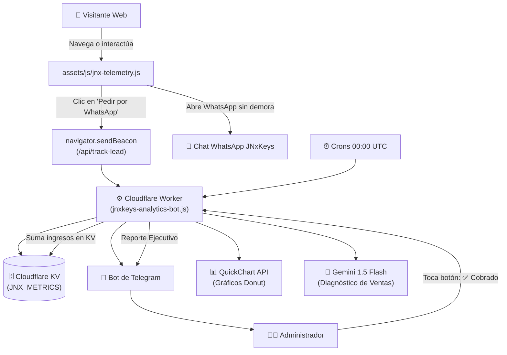

# 📡 Guía Maestra: Telemetría, Cloudflare Worker y Bot de Telegram para JNxKeys

Este documento describe la arquitectura, configuración y despliegue del sistema de telemetría sin costo ($0.00/mes) diseñado para **JNxKeys** (`https://jnxkeys.com/`), adaptado del modelo probado en **Dolcharamand**.

---

## 🎯 Objetivo de Negocio: Medir Intención, Demanda y Horarios

Dado que en JNxKeys el cierre comercial se realiza a través de **WhatsApp** (Yape/Plin), el sistema no intenta perfilar identidades antes del contacto, sino medir con precisión quirúrgica:

1. **Intención de Compra por Producto:** Qué producto o combo específico motivó el clic a WhatsApp.
2. **Mapa de Calor Horario (Heatmap 24h):** En qué franja horaria llegan más clientes (Madrugada 00-06h, Mañana 06-12h, Tarde 12-18h, Noche 18-24h) para programar ofertas relámpago y atención inmediata en WhatsApp.
3. **Embudo de Conversión Real:**
   $$\text{Visitas Reales (Cloudflare)} \longrightarrow \text{Intención WhatsApp (Leads)} \longrightarrow \text{Ventas Pagadas (Bot Telegram)}$$
4. **Validación de Cierre en 1 Tap:** Botones interactivos en Telegram (`[✅ Cobrado S/ 70]`, `[❌ Solo Curioso]`) para registrar la venta en Cloudflare KV sin abrir hojas de cálculo.
5. **Auditoría con IA (Gemini 1.5 Flash):** Análisis diario automático con sugerencias operativas de pricing y promociones.

---

## 🏗️ Componentes del Sistema



---

## 🚀 Despliegue en Cloudflare (Paso a Paso en 5 Minutos)

### Paso 1: Crear el Bot de Telegram
1. En Telegram, busca a [@BotFather](https://t.me/BotFather) y envía `/newbot`.
2. Asigna un nombre: `JNxKeys Telemetry Bot`.
3. Asigna un usuario: ej. `jnxkeys_telemetry_bot`.
4. Copia el **Bot Token** generado (ej. `7123456789:AAH...`).
5. Busca a [@userinfobot](https://t.me/userinfobot) y envía `/start` para obtener tu **Chat ID** numérico personal.

---

### Paso 2: Crear el KV Namespace en Cloudflare
Desde tu terminal en la raíz del proyecto `JNxKeys`:

```bash
# Iniciar sesión en Cloudflare si no lo has hecho
npx wrangler login

# Crear el namespace KV para métricas
npx wrangler kv namespace create JNX_METRICS
```

Copia el `id` que te devuelve la terminal y pégalo en [wrangler.toml](file:///c:/Users/JuNz-Dev/Documents/antigravity/JNxKeys/wrangler.toml) reemplazando `REEMPLAZAR_CON_TU_KV_ID`.

---

### Paso 3: Configurar Secretos en Cloudflare Worker
Ejecuta los siguientes comandos para almacenar de forma segura tus credenciales:

```bash
# 1. Token de tu Bot de Telegram
npx wrangler secret put TELEGRAM_BOT_TOKEN

# 2. Token de API de Cloudflare (Permisos: Zone > Analytics > Read)
npx wrangler secret put CF_API_TOKEN

# 3. API Key de Google Gemini (Gratis en https://aistudio.google.com/)
npx wrangler secret put GEMINI_API_KEY
```

En [wrangler.toml](file:///c:/Users/JuNz-Dev/Documents/antigravity/JNxKeys/wrangler.toml), actualiza:
- `TELEGRAM_CHAT_ID = "TU_CHAT_ID_AQUI"`
- `CF_ZONE_ID = "TU_ZONE_ID_DE_JNXKEYS_COM"` (Se encuentra en el resumen de tu dominio en Cloudflare).

---

### Paso 4: Desplegar el Worker
```bash
npx wrangler deploy
```

---

### Paso 5: Enlazar Rutas y Activar Webhook de Telegram
1. **Ruta en Cloudflare Dashboard:**
   - Ve a **Workers & Pages** > `jnxkeys-analytics-bot` > **Settings** > **Domains & Routes**.
   - Añade la ruta: `jnxkeys.com/api/*` asociada a tu zona `jnxkeys.com`.
   - Con esto, todo llamado a `/api/track-lead` o `/api/track-view` irá directo a tu worker sin necesidad de CORS.

2. **Registrar el Webhook de Telegram:**
   Abre tu navegador o ejecuta en terminal sustituyendo tus valores:
   ```bash
   curl "https://api.telegram.org/bot<TU_BOT_TOKEN>/setWebhook?url=https://jnxkeys.com/api/telegram-webhook"
   ```

---

## 📱 Comandos del Bot de Telegram

| Comando | Acción |
| :--- | :--- |
| `/resumen` | Resumen del día: Leads WhatsApp, Ventas cerradas, Ingresos totales (S/) y Tasa de conversión. |
| `/horarios` | **Mapa de calor 24h**: Desglose por cuadrantes (Madrugada, Mañana, Tarde, Noche) para saber cuándo lanzar promos relámpago. |
| `/top` | Top 5 de productos con mayor intención de compra y gráficos visuales Donut. |
| `/visitas` | Tráfico real de Cloudflare (Visitas únicas y peticiones HTTP) vs Leads generados. |
| `/semana` | Reporte acumulado semanal de los últimos 7 días con IA. |
| `/mes` | Cierre mensual con total de ingresos y productos estrella. |
| `/venta <monto> <producto>` | Registro manual rápido de una venta si el cliente transfirió fuera del botón. |

---

## 🔍 Solución al Inspector de LinkedIn ("Author: No author found")

Si LinkedIn Post Inspector mostró *"Author: No author found"*:

### ¿Por qué ocurrió?
1. **Detección Automática de Artículo:** En la cabecera existía la etiqueta `<meta property="article:published_time" content="...">`. LinkedIn, al detectar un tag de artículo, cataloga la página como `Type: Article` en lugar de un sitio web genérico y exige obligatoriamente un autor.
2. **Especificación Estricta de Open Graph:** La especificación de Open Graph para `article:author` exige una URL de perfil (`https://jnxkeys.com/nosotros/`), mientras que LinkedIn también busca `<meta name="author">` y el nodo `Article` en Schema.org LD+JSON.
3. **Caché Persistente de LinkedIn (7 días):** LinkedIn almacena en caché el resultado del primer escaneo. Aunque el código se actualice en GitHub Pages, LinkedIn no consulta la web en vivo hasta que se fuerza una re-inspección.

### ¿Qué se implementó en el código?
En [index.html](file:///c:/Users/JuNz-Dev/Documents/antigravity/JNxKeys/index.html) y en todas las subpáginas activas se incluyeron todas las variantes compatibles:
```html
<meta name="author" content="JNxConsulting">
<meta property="author" content="JNxConsulting">
<meta property="og:author" content="JNxConsulting">
<meta property="article:author" content="https://jnxkeys.com/nosotros/">
<meta name="DC.creator" content="JNxConsulting">
<meta name="creator" content="JNxConsulting">
<meta name="twitter:creator" content="JNxConsulting">
```
Además, se agregó al bloque Schema.org LD+JSON el nodo formal `@type: "Article"` con `author: { "@type": "Organization", "name": "JNxConsulting" }`.

### ¿Cómo refrescar LinkedIn de inmediato?
1. Ingresa a [LinkedIn Post Inspector](https://www.linkedin.com/post-inspector/).
2. Ingresa `https://jnxkeys.com/` (o con parámetro para forzar omisión de caché: `https://jnxkeys.com/?inspect=1`).
3. Haz clic en **Inspect**. LinkedIn descargará el HTML actualizado y mostrará `JNxConsulting` como autor verificado.
